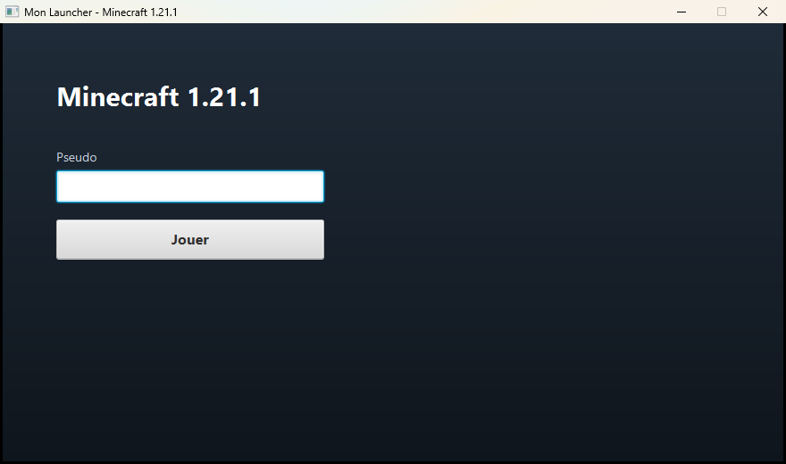
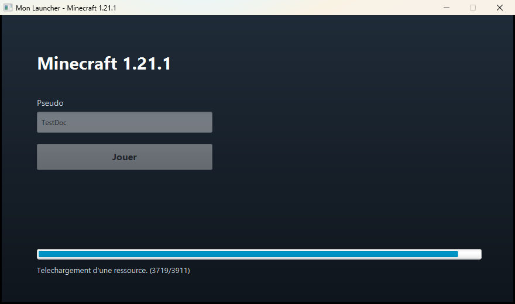

# 2. Tutoriel : un launcher basique

Dans ce tutoriel, on construit un launcher complet pour **Minecraft 1.21.1 vanilla** :

- une fenêtre avec un champ « Pseudo » et un bouton « Jouer » ;
- au clic, le launcher télécharge tout ce qui manque (≈ 1 Go la première fois),
  y compris Java 21, en affichant la progression ;
- puis il lance le jeu avec un compte hors ligne.

Pas de serveur à héberger : tout vient des serveurs officiels de Mojang.



Le projet terminé se trouve dans [`examples/launcher-basique`](../examples/launcher-basique) :
vous pouvez le compiler directement ou le suivre pas à pas ci-dessous.

**Prérequis** : avoir suivi l'[installation](01-installation.md) (JDK 8 avec JavaFX, et
`mvn install` de la lib effectué).

---

## Étape 1 — Créer le projet

```
mon-launcher/
├── pom.xml
└── src/main/java/com/exemple/launcher/
    ├── MonLauncher.java      point d'entrée : prépare le moteur et la fenêtre
    ├── LauncherPanel.java    contenu de la fenêtre et bouton Jouer
    └── MojangVersions.java   trouve le JSON officiel d'une version
```

Le `pom.xml` est celui décrit dans l'[installation](01-installation.md#ajouter-la-lib-à-votre-launcher) :
la dépendance `alternative-api` et le plugin shade, avec
`com.exemple.launcher.MonLauncher` comme classe principale. Le fichier complet est
[ici](../examples/launcher-basique/pom.xml).

## Étape 2 — Trouver le JSON de la version

Chaque version de Minecraft est décrite par un **fichier JSON** publié par Mojang : il
liste le jar du client, les librairies, les assets, la version de Java requise, les
arguments de lancement… C'est ce fichier que la lib lit pour savoir quoi télécharger.

Mojang publie l'URL de chacun de ces JSON dans un *manifest* :
`https://piston-meta.mojang.com/mc/game/version_manifest_v2.json`. On écrit une petite
classe qui y cherche notre version :

```java
package com.exemple.launcher;

import java.io.IOException;
import java.io.InputStream;
import java.io.InputStreamReader;
import java.io.Reader;
import java.net.URL;
import java.net.URLConnection;
import java.nio.charset.StandardCharsets;

import com.google.gson.JsonElement;
import com.google.gson.JsonObject;
import com.google.gson.JsonParser;

public final class MojangVersions {

    private static final String MANIFEST_URL =
            "https://piston-meta.mojang.com/mc/game/version_manifest_v2.json";

    private MojangVersions() {
    }

    /** @return l'URL du JSON de la version demandée, par exemple "1.21.1" */
    public static String resolveVersionJsonUrl(String versionId) throws IOException {
        URLConnection connection = new URL(MANIFEST_URL).openConnection();
        connection.setConnectTimeout(10000);
        connection.setReadTimeout(10000);

        try (InputStream in = connection.getInputStream();
             Reader reader = new InputStreamReader(in, StandardCharsets.UTF_8)) {
            JsonObject manifest = JsonParser.parseReader(reader).getAsJsonObject();
            for (JsonElement element : manifest.getAsJsonArray("versions")) {
                JsonObject version = element.getAsJsonObject();
                if (versionId.equals(version.get("id").getAsString())) {
                    return version.get("url").getAsString();
                }
            }
        }
        throw new IOException("Version de Minecraft inconnue : " + versionId);
    }
}
```

Gson est fourni par AlternativeAPI (dépendance transitive) : rien à ajouter au `pom.xml`.

> Vous pourriez aussi coller en dur l'URL du JSON (elle ne change jamais pour une
> version donnée). Passer par le manifest permet de changer de version en modifiant
> une seule constante.

## Étape 3 — La classe principale

`MonLauncher` hérite d'`AlternativeBase`, qui est une `javafx.application.Application`.
Sa méthode `start` assemble les quatre briques de la lib (détaillées dans
[Concepts](03-concepts.md)) :

```java
package com.exemple.launcher;

import fr.trxyy.alternative.alternative_api.GameEngine;
import fr.trxyy.alternative.alternative_api.GameFolder;
import fr.trxyy.alternative.alternative_api.GameLinks;
import fr.trxyy.alternative.alternative_api.GameStyle;
import fr.trxyy.alternative.alternative_api.LauncherPreferences;
import fr.trxyy.alternative.alternative_api.utils.Mover;
import fr.trxyy.alternative.alternative_api_ui.LauncherAlert;
import fr.trxyy.alternative.alternative_api_ui.LauncherPane;
import fr.trxyy.alternative.alternative_api_ui.base.AlternativeBase;
import fr.trxyy.alternative.alternative_api_ui.base.LauncherBase;
import javafx.application.Platform;
import javafx.scene.Scene;
import javafx.scene.control.Alert.AlertType;
import javafx.stage.Stage;
import javafx.stage.StageStyle;

public class MonLauncher extends AlternativeBase {

    /** La version de Minecraft que ce launcher installe et lance. */
    public static final String MC_VERSION = "1.21.1";

    public static void main(String[] args) {
        launch(args);
    }

    @Override
    public void start(Stage primaryStage) {
        // 1. Dossier d'installation : %APPDATA%\.monlauncher sous Windows
        GameFolder gameFolder = new GameFolder("monlauncher");

        // 2. Titre et taille de la fenêtre du launcher
        LauncherPreferences preferences = new LauncherPreferences(
                "Mon Launcher - Minecraft " + MC_VERSION, 880, 520, Mover.DONT_MOVE);

        // 3. Où trouver le JSON de la version
        GameLinks gameLinks;
        try {
            gameLinks = new GameLinks(MojangVersions.resolveVersionJsonUrl(MC_VERSION));
        } catch (Exception e) {
            new LauncherAlert("Impossible de joindre les serveurs de Mojang :\n" + e.getMessage(), AlertType.ERROR);
            Platform.exit();
            return;
        }

        // 4. Le moteur relie le tout
        GameEngine gameEngine = new GameEngine(gameFolder, gameLinks, preferences, GameStyle.VANILLA_1_19_HIGHER);
        gameEngine.setRequestedVersionId(MC_VERSION);

        // 5. L'interface
        LauncherPane root = new LauncherPane(gameEngine);
        new LauncherPanel(root, gameEngine);

        // 6. Configure la fenêtre et l'affiche
        new LauncherBase(primaryStage, new Scene(root), StageStyle.DECORATED, gameEngine);
    }
}
```

Ligne par ligne :

1. **`GameFolder("monlauncher")`** — le dossier où tout sera installé :
   `%APPDATA%\.monlauncher` sous Windows. Choisissez un nom propre à votre launcher
   pour ne pas mélanger ses fichiers avec ceux d'un autre.
2. **`LauncherPreferences`** — titre de la fenêtre, largeur et hauteur en pixels.
   `Mover.DONT_MOVE` : la fenêtre garde sa barre de titre Windows, inutile de la rendre
   déplaçable à la souris. (Avec une fenêtre sans bordure, on utiliserait `Mover.MOVE`.)
3. **`GameLinks(url)`** — avec une seule URL, la lib utilise directement le JSON de
   Mojang, sans aucune fonction serveur (maintenance, fichiers perso…). C'est le mode
   le plus simple.
4. **`GameEngine`** — l'objet central, passé à tous les autres. `GameStyle` indique
   *comment* installer et lancer le jeu : `VANILLA_1_19_HIGHER` correspond à Minecraft
   vanilla 1.19 et plus. `setRequestedVersionId` nomme le profil de jeu (le
   sous-dossier `bin/game/vanilla_1_19_higher-1.21.1`).
5. **`LauncherPane`** — un `Pane` JavaFX aux dimensions du launcher, que
   `LauncherPanel` va remplir.
6. **`LauncherBase`** — applique le titre et la taille, ferme proprement l'application
   quand on ferme la fenêtre, puis l'affiche.

## Étape 4 — L'interface

`LauncherPanel` hérite d'`IScreen`, une classe de la lib qui fournit des utilitaires
(images, fond, liens… voir [Interface](07-interface.md)). Les composants de la lib
(`LauncherLabel`, `LauncherTextField`, `LauncherButton`, `LauncherProgressBar`) sont des
composants JavaFX standards qui **s'ajoutent eux-mêmes** au panneau passé au
constructeur et qu'on positionne avec `setBounds(x, y, largeur, hauteur)` :

```java
public class LauncherPanel extends IScreen {

    private final GameEngine gameEngine;
    private final LauncherTextField usernameField;
    private final LauncherButton playButton;
    private final LauncherProgressBar progressBar;
    private final LauncherLabel statusLabel;
    private Timeline progressTimeline;

    public LauncherPanel(Pane root, GameEngine gameEngine) {
        this.gameEngine = gameEngine;
        root.setStyle("-fx-background-color: linear-gradient(to bottom, #1f2b38, #0f151c);");

        LauncherLabel title = new LauncherLabel(root);
        title.setText("Minecraft " + MonLauncher.MC_VERSION);
        title.setStyle("-fx-text-fill: white; -fx-font-size: 30px; -fx-font-weight: bold;");
        title.setBounds(60, 60, 500, 44);

        LauncherLabel usernameLabel = new LauncherLabel(root);
        usernameLabel.setText("Pseudo");
        usernameLabel.setStyle("-fx-text-fill: #c9d4df; -fx-font-size: 14px;");
        usernameLabel.setBounds(60, 140, 300, 20);

        this.usernameField = new LauncherTextField(root);
        this.usernameField.setVoidText("Steve");          // texte affiché quand le champ est vide
        this.usernameField.setBounds(60, 165, 300, 36);

        this.playButton = new LauncherButton("Jouer", root);
        this.playButton.setStyle("-fx-font-size: 16px; -fx-font-weight: bold;");
        this.playButton.setBounds(60, 220, 300, 44);
        this.playButton.setOnAction(event -> play());

        this.progressBar = new LauncherProgressBar(root);
        this.progressBar.setBounds(60, 400, 760, 18);
        this.progressBar.setVisible(false);

        this.statusLabel = new LauncherLabel(root);
        this.statusLabel.setStyle("-fx-text-fill: #c9d4df; -fx-font-size: 13px;");
        this.statusLabel.setBounds(60, 425, 760, 22);
    }
```

> `LauncherButton` propose aussi `setAction(...)`, qui ne réagit qu'au clic de souris.
> `setOnAction(...)` (hérité de `Button`) réagit aussi à la touche Entrée ou Espace.

## Étape 5 — Lancer le jeu

Au clic sur « Jouer », trois choses : créer la **session** du joueur, régler les
options du jeu, démarrer le **`GameUpdater`**.

```java
    private void play() {
        String username = this.usernameField.getText().trim();
        if (!username.matches("[A-Za-z0-9_]{3,16}")) {
            new LauncherAlert("Le pseudo doit faire de 3 à 16 caractères (lettres, chiffres ou _).", AlertType.WARNING);
            return;
        }

        // Compte hors ligne : aucun mot de passe, aucune vérification de licence.
        GameAuth auth = new GameAuth(username, "", AccountType.OFFLINE);
        // UUID stable pour ce pseudo (voir plus bas)
        Session session = auth.getSession();
        session.setUuid(offlineUuid(username));

        // Options du jeu
        this.gameEngine.reg(GameMemory.RAM_2G);
        this.gameEngine.reg(GameSize.DEFAULT);

        // Le GameUpdater est un Thread : il télécharge ce qui manque, puis lance le jeu.
        GameUpdater updater = new GameUpdater();
        updater.reg(this.gameEngine);
        updater.reg(session);
        this.gameEngine.reg(updater);

        this.playButton.setDisable(true);
        this.usernameField.setDisable(true);
        this.progressBar.setVisible(true);
        updater.start();

        // La lib n'émet pas d'événements de progression : on lit son état régulièrement.
        this.progressTimeline = new Timeline(new KeyFrame(Duration.millis(200), event -> refreshProgress(updater)));
        this.progressTimeline.setCycleCount(Animation.INDEFINITE);
        this.progressTimeline.play();
    }

    /** UUID hors ligne de Minecraft : celui qu'un serveur en online-mode=false attribue au pseudo. */
    private static String offlineUuid(String username) {
        byte[] seed = ("OfflinePlayer:" + username).getBytes(StandardCharsets.UTF_8);
        return UUID.nameUUIDFromBytes(seed).toString().replace("-", "");
    }
```

Points importants :

- **Compte hors ligne** : `GameAuth(pseudo, "", AccountType.OFFLINE)` fabrique une
  session sans rien vérifier. Le joueur peut jouer en solo et sur les serveurs
  configurés en `online-mode=false`. Pour les comptes Microsoft (achat du jeu vérifié),
  voir [Authentification](06-authentification.md).
- **UUID stable** : en mode hors ligne, la lib attribue un UUID *aléatoire* à chaque
  connexion. Or Minecraft range les progrès et statistiques du joueur par UUID : ils
  sembleraient remis à zéro à chaque partie. On remplace donc l'UUID par l'UUID hors
  ligne standard, toujours le même pour un pseudo donné.
- **`engine.reg(...)`** : c'est ainsi qu'on donne au moteur ses réglages optionnels
  (mémoire, taille de fenêtre, serveur, arguments…). Voir [Options de jeu](05-options-de-jeu.md).
- **Un `GameUpdater` par lancement** : c'est un `Thread`, il ne peut être démarré
  qu'une fois. Les trois `reg` sont obligatoires : le moteur, la session, et
  l'enregistrement de l'updater dans le moteur (la lib s'en sert pendant le
  téléchargement).

## Étape 6 — Afficher la progression

Le `GameUpdater` expose des compteurs publics et un texte d'état. On les lit toutes les
200 ms depuis le thread JavaFX :

```java
    private void refreshProgress(GameUpdater updater) {
        int total = updater.filesToDownload;
        int done = updater.downloadedFiles;
        this.progressBar.setProgress(total > 0 ? (double) done / total : ProgressBar.INDETERMINATE_PROGRESS);

        String info = updater.getCurrentInfo() == null ? "" : updater.getCurrentInfo();
        this.statusLabel.setText(total > 0 ? info + " (" + done + "/" + total + ")" : info);

        // Le thread se termine quand le jeu est fermé, ou plus tôt en cas d'échec.
        if (!updater.isAlive()) {
            this.progressTimeline.stop();
            if (updater.hasDownloadError()) {
                this.statusLabel.setText("Échec : " + updater.getFailedDownloads().size()
                        + " fichier(s) n'ont pas pu être téléchargés. Vérifiez votre connexion et réessayez.");
                this.playButton.setDisable(false);
                this.usernameField.setDisable(false);
            }
        }
    }
}
```

Le cycle de vie du thread est le suivant :

1. il télécharge et vérifie les fichiers (les compteurs avancent) ;
2. si un téléchargement a échoué, il **s'arrête sans lancer le jeu** :
   `hasDownloadError()` vaut `true` et la fenêtre du launcher reste affichée ;
3. sinon il **masque la fenêtre du launcher**, lance Minecraft et **attend la
   fermeture du jeu** ; le thread se termine à ce moment-là.

Avec le comportement par défaut de JavaFX, masquer la dernière fenêtre arrête
l'interface : le launcher se ferme donc tout seul quand le joueur quitte Minecraft. Pour
le garder ouvert, voir [Mise à jour et lancement](04-mise-a-jour-et-lancement.md#garder-le-launcher-ouvert-pendant-le-jeu).

Les imports de `LauncherPanel` :

```java
import java.nio.charset.StandardCharsets;
import java.util.UUID;

import fr.trxyy.alternative.alternative_api.GameEngine;
import fr.trxyy.alternative.alternative_api.GameMemory;
import fr.trxyy.alternative.alternative_api.GameSize;
import fr.trxyy.alternative.alternative_api.updater.GameUpdater;
import fr.trxyy.alternative.alternative_api_ui.LauncherAlert;
import fr.trxyy.alternative.alternative_api_ui.base.IScreen;
import fr.trxyy.alternative.alternative_api_ui.components.LauncherButton;
import fr.trxyy.alternative.alternative_api_ui.components.LauncherLabel;
import fr.trxyy.alternative.alternative_api_ui.components.LauncherProgressBar;
import fr.trxyy.alternative.alternative_api_ui.components.LauncherTextField;
import fr.trxyy.alternative.alternative_auth.account.AccountType;
import fr.trxyy.alternative.alternative_auth.account.Session;
import fr.trxyy.alternative.alternative_auth.base.GameAuth;
import javafx.animation.Animation;
import javafx.animation.KeyFrame;
import javafx.animation.Timeline;
import javafx.scene.control.Alert.AlertType;
import javafx.scene.control.ProgressBar;
import javafx.scene.layout.Pane;
import javafx.util.Duration;
```

## Étape 7 — Compiler et tester

```bash
mvn clean package
java -jar target/MonLauncher.jar
```

Saisissez un pseudo, cliquez sur « Jouer » :



Au premier lancement, la lib télécharge environ 1 Go (assets, librairies, jar du client,
Java 21). Les lancements suivants ne retéléchargent que ce qui manque ou a changé et
démarrent en quelques secondes.

Une fois le jeu lancé, votre dossier ressemble à ceci :

```
%APPDATA%\.monlauncher\
├── assets\              index, objets (sons, langues...) et config log4j
├── bin\
│   ├── game\
│   │   ├── vanilla_1_19_higher-1.21.1\   dossier du jeu (saves, options.txt...)
│   │   └── _shared-userdata\              réglages partagés entre profils
│   ├── java-runtime-delta\                Java 21 téléchargé pour cette version
│   ├── natives\  cache_natives\           librairies natives (LWJGL...)
│   └── versions\1.21.1\1.21.1.jar         jar du client
├── cache\1.21.1.json    copie du JSON de la version
├── libraries\           librairies Java du jeu
└── logs\latest-game.log sortie du jeu (utile en cas de crash)
```

La sortie de la lib s'affiche dans la console (`[AUpdater] ...`) : lancez le jar depuis
un terminal pour la voir.

## Aller plus loin

| Je veux… | Où regarder |
|---|---|
| Lancer une autre version | Changer `MC_VERSION` et choisir le bon `GameStyle` : [Concepts](03-concepts.md#gamestyle) |
| Des comptes Microsoft | [Authentification](06-authentification.md) |
| Une image de fond, un logo, une fenêtre sans bordure | [Interface](07-interface.md) |
| Plus de mémoire, une taille de fenêtre, la connexion auto à mon serveur | [Options de jeu](05-options-de-jeu.md) |
| Installer mes mods, un mode maintenance | [Serveur de fichiers](08-serveur-de-fichiers.md) |
| Forge, Fabric, NeoForge… | [Modloaders](09-modloaders.md) |

> ⚠️ **Avant d'aller plus loin, lisez [le nettoyage du dossier `bin`](04-mise-a-jour-et-lancement.md#le-nettoyage-du-dossier-bin)** :
> à chaque lancement, la lib supprime de `bin/` les fichiers qu'elle ne connaît pas
> (sauf mondes, mods, configs, options…). Un dossier ajouté par un mod ou par le joueur
> peut disparaître si vous ne le déclarez pas.
